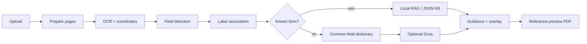
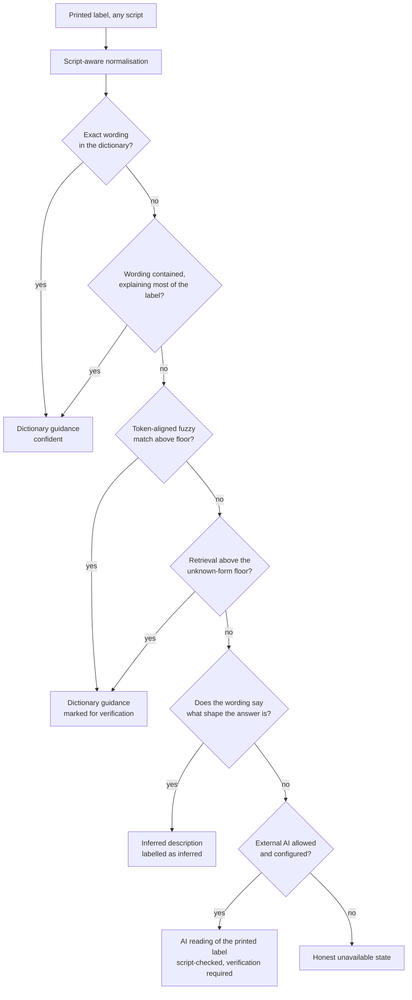

# FormSathi: AI-Powered Multilingual Form Assistant

FormSathi analyzes an uploaded form, detects fillable fields, explains each field in simple language, highlights where the answer belongs, provides English, Hindi, Kannada, and Urdu text and voice guidance, collects answers locally, and generates a **Completed Reference Preview** for the user to copy onto the official form.

It works on forms it has never seen before. An **unknown form** in any of the four supported scripts is resolved field by field against a multilingual field dictionary, so an unrecognised form behaves like a known one: every field gets a name, a plain-language description, an expected format, a validation rule, and an answer box that feeds the same reference preview.

The **explanation language can be switched at any moment** and changes only the guidance. The uploaded form is never translated, re-read, or altered, and answers already typed are never disturbed.

## Problem statement

Government, banking, insurance, educational, and financial forms often use unfamiliar terminology and dense layouts. First-time users may know their own information but not what a field asks, why it is required, which format it expects, or where the answer belongs. Existing tools often stop at OCR or generic chat and do not connect guidance to the exact region on the page.

## Project objective

Build a hybrid Computer Vision + RAG assistant that localizes fields, retrieves trusted guidance for known synthetic forms, explains unknown fields in the user's own language without inventing official rules, and keeps the user in control of every answer.

## Product boundary and disclaimer

FormSathi is an **academic demonstration**, not an official submission service.

It does not:

- submit a form to a government, bank, insurer, school, or third party
- claim legal, financial, or government approval
- invent required values or official field meanings
- sign a document or imitate a signature
- silently alter the official source upload
- send user-entered personal values to an external LLM

Users remain responsible for verifying official instructions. Avoid highly sensitive real forms unless you trust the deployment environment.

## Features

### Reading the form

- PNG, JPG, JPEG, WEBP, and PDF upload with MIME validation
- **Table-structure extraction**: the rules on a ruled form are found, the cells between
  them derived, and OCR words assigned to cells, so every row of a government table
  becomes a field. Handles a caption and its blank sharing one cell
  (`Elector Name: ______`), nested column headings, and tables inside tables
- **Instruction pages are recognised and left alone**: judged from the writing itself,
  before any blank is looked for, so a sentence that happens to end in a colon cannot
  turn an information sheet into a form
- **Nothing is proposed on top of printed text**: a blank is somewhere to write, so every
  candidate is checked against the words already read and discarded where it overlaps one.
  A line wider than half the page is prose even when it ends in a colon, which is the only
  test that works in a language where five words fill a line
- **Both columns of a comparison table are fields**: a row that asks for the elector's name
  in the roll and as claimed produces two blanks, and a column whose caption OCR missed no
  longer cancels the column that was read
- **Signature and attestation lines are found wherever they sit**: the elector's own
  signature line in the middle of a page, not just the officer's block at the foot of it
- **The page is only cropped when it is a photograph on a background**: a candidate edge
  must cover most of the frame and reach all four sides, so a ruled table can no longer
  be mistaken for the page and silently delete the rest of the form
- Page rendering, preprocessing, Tesseract OCR with word coordinates
- **Script-aware OCR**: the page's script is detected, then read with that language model plus English, instead of loading every alphabet at once
- **Two readings of every page** (rules erased and rules intact), merged word by word, so a label that one pass misses the other recovers
- Detection of boxes, underlines, checkboxes, radios, dates, and signature areas
- **Direction-aware label association**: labels are found to the left of a blank on a left-to-right page and to its *right* on an Urdu page, and are returned in reading order
- **Targeted label re-reading**: a field that ends up with no label has the region its label must occupy cropped and read on its own

### Understanding the form

- **Context-aware field interpretation**: each blank is read together with the caption
  beside it, the column header above it, and the section it sits under. This is what
  separates two cells both captioned `Name:` under different headings, recognises
  `AC Name` as an Assembly Constituency rather than a person, and tells a field the
  applicant fills from one the office fills
- **Office-use fields are marked and have no answer box**, so the applicant is never
  invited to complete a block meant for a verifying officer
- Known-form fingerprint matching against the seeded knowledge base
- **Multilingual common-field dictionary**: 56 fields, 927 printed wordings across English, Hindi, Kannada, and Urdu, matched in native script
- **Noise-tolerant matching**: exact wording, contained wording, and token-aligned fuzzy matching, so `Dato of Birlh` still resolves to date of birth
- **Honest fallbacks**: a label the dictionary does not know is described by what it *asks for* (a name, a number, a date, an amount, an address, a choice, or an office-use block) and labelled as inferred, rather than guessed at
- Local knowledge-base RAG plus lexical fallback, with a higher bar on unknown forms so a weak vector hit cannot pose as a dictionary match
- Optional Groq interpretation for unrecognised fields only, with responses rejected when they are not written in the script that was asked for

### Using the form

- English, Hindi, Kannada, and **Urdu** stored guidance and browser text-to-speech
- **On-the-go explanation language switching**: all four languages arrive in one request, so changing language is instant, works offline, and provably leaves the form and the typed answers untouched
- Right-to-left rendering for Urdu guidance, applied per element so the form's own labels keep their own direction
- **Per-field validation rules** for unknown forms too: dates, mobile numbers, PIN codes, Aadhaar, PAN, IFSC, bank accounts, email, amounts, years, and names, with messages in the chosen language
- Devanagari, Kannada, and Arabic-Indic digits accepted wherever a number is expected
- **Worked examples in the reader's own script**: a name shown beside Kannada guidance is
  written in Kannada, not Latin letters. Values that read the same everywhere — a date, a
  PIN code, an IFSC — stay identical across the four languages
- **Read-aloud works in all four languages, whatever voices the device has**: a Windows
  machine usually ships English only, and the play button used to disable itself for
  Kannada and Urdu. It now reads with the closest installed voice — Kannada through
  Telugu, Tamil, Malayalam or Hindi, Urdu through Arabic, Persian or Hindi — and names the
  substitute, so approximate pronunciation is not mistaken for a bad translation. The
  voice list loads asynchronously, so it is watched rather than read once
- Non-destructive answer overlay and Completed Reference Preview PDF, with HarfBuzz shaping so answers typed in any of the four scripts render correctly
- Delete and start-over cleanup

## Architecture



### Known-form flow

OCR and layout features → fingerprint match → local field chunks → trusted multilingual guidance.

### Unknown-form flow

This is the path taken whenever the uploaded form is not one of the seeded demo forms, which in practice is almost every real upload. It is designed to work with no network access at all.



Each step is less certain than the one above it, and the interface says which one answered. The first four need no network.

**Resolution order and what the user sees**

| Source | When it applies | Shown as |
| --- | --- | --- |
| Known form knowledge base | The form was recognised | Known Form Knowledge Base |
| Page interpretation | The blank was read in context, with its column headings and the document's glossary | Read From This Page, "verify" |
| Page interpretation (English only) | The blank was read, but the four-language step failed for it | Read From This Page, "verify" |
| Common field dictionary (confident) | The printed wording matches a known wording | Common Field Dictionary |
| Common field dictionary (plausible) | A fuzzy or partial match, typical of a noisy scan | Common Field Dictionary, "verify" |
| Label pattern heuristic | Nothing read the blank, and the wording reveals only the *shape* of the answer | Inferred From Printed Label |
| General AI guidance | Opt-in, for wordings nothing else covers | General AI Guidance, "verify" |
| Unavailable | Nothing honest can be said | Guidance unavailable |

**"Inferred" means inferred.** A reading made with the column headings and the glossary in
hand is not a guess, and is no longer badged as one: an answer that said "Read From This
Page, 88% confidence" and "Inferred from the printed wording" at the same time was telling
the user two contradictory things. The inferred badge now appears only on the shape
heuristic, which is the one source that really is working from wording alone. Everything
still asks to be checked against the form.

**Supported languages.** English, Hindi, Kannada, and Urdu, in native script. Urdu is rendered right-to-left.

**Changing the explanation language.** `POST /api/documents/{id}/guidance/bundle` returns every requested field in every requested language in one response. The browser holds the bundle, so switching language is a local lookup. This is deliberate: a language switch cannot re-read the form, cannot fail on a slow connection, and cannot disturb answers already typed. The form's own printed content is never translated — only FormSathi's description of each field changes.

## Technology stack

- Frontend: React, TypeScript, Vite, Tailwind CSS, Lucide, Vitest
- Backend: FastAPI, Pydantic v2, OpenCV, Pillow, PyMuPDF, Tesseract, SQLite, ChromaDB, Sentence Transformers
- Text shaping: HarfBuzz (`uharfbuzz`) and FreeType (`freetype-py`), used to render Devanagari, Kannada, and Urdu correctly in the reference preview. Pillow only shapes these scripts when built with libraqm, which a plain `pip install pillow` on Windows is not.
- LLM: Groq OpenAI-compatible API behind a provider interface (optional)

## Installation with Docker

```bash
docker compose up --build
```

- Frontend: http://localhost:5173
- Backend: http://localhost:8000
- Swagger: http://localhost:8000/docs

## Local installation

### Backend (Windows / macOS / Linux)

```bash
cd backend
python -m venv .venv
# Windows
.venv\Scripts\activate
# macOS / Linux
source .venv/bin/activate
pip install -r requirements.txt
uvicorn app.main:app --reload --host 0.0.0.0 --port 8000
```

### Tesseract

Tesseract needs the language data for every script you want to read. `TESSERACT_LANG` defaults to `eng+hin+kan+urd`.

- Windows: install UB-Mannheim Tesseract and set `TESSERACT_CMD=C:\Program Files\Tesseract-OCR\tesseract.exe`. Alternatively `scoop install tesseract`, then place the `eng`, `hin`, `kan`, `urd`, and `osd` `.traineddata` files in the install's `tessdata` folder.
- macOS: `brew install tesseract tesseract-lang`
- Linux: `sudo apt-get install tesseract-ocr tesseract-ocr-eng tesseract-ocr-hin tesseract-ocr-kan tesseract-ocr-urd tesseract-ocr-osd`

`osd.traineddata` is what lets FormSathi detect a page's script before reading it. Without it the reader starts with English and widens only if that reading comes out poor, which still works but reads regional scripts less accurately.

Confirm what is installed with `tesseract --list-langs`.

### Frontend

```bash
cd frontend
npm install
npm run dev
```

### Knowledge and samples

```bash
python scripts/_write_knowledge.py          # seeded known forms
python scripts/build_field_dictionary.py    # multilingual common-field dictionary
python scripts/generate_samples.py          # known-form samples
python scripts/generate_unknown_samples.py  # unknown-form samples, en / hi / kn / ur
python scripts/seed_knowledge_base.py       # index both into the vector store
```

`build_field_dictionary.py` regenerates `backend/knowledge_base/common_fields.json` and `label_patterns.json` from the readable sources in `scripts/field_dictionary/`. It refuses to write if any field is missing one of the four languages, so a half-translated entry cannot reach the runtime.

## Complex forms and the page interpreter

A lexical dictionary can only see one caption at a time, and on a real government form
that is not enough. The ECI declaration form (Annexure-IV) prints `Name:` and
`Relative's Name:` twice each on the same row under two different column headings, uses
`AC Name` for an Assembly Constituency, and ends with blocks only a Booth Level Officer
may complete. Matched caption by caption, `Mobile Number` came out as a bank account
number and a garbled column heading came out as a PIN code — confident, and wrong.

So on an unknown form FormSathi reads the document, then the page, then the caption:

0. **Document context.** Every page's text, instruction sheets included, is read once to
   establish what the form is: its title, the issuing authority, its purpose, and a
   glossary of its abbreviations. On the ECI form this yields `AC = Assembly
   Constituency` and `EPIC = Electoral Photo Identity Card`, which is precisely what
   stops "AC No." being explained as a bank account number. The glossary is prepended to
   every later request and shown in the interface.
0b. **Background lookup (optional).** With a web-search model configured, the form is
   looked up online by its printed title, to fill gaps the pages left — an initialism the
   form never spells out, an issuing body it never names. Findings never override the
   paper, and the sources are shown. Off by default; see below.
1. **Structure.** The rules are found, the cells derived, and every blank recorded with
   the caption beside it, the column header above it, and the section it belongs to.
2. **Classification.** One compact request per batch asks what each blank is, in English:
   which dictionary concept, who fills it, what to write, how sure. The column headers and
   the document glossary go with it, which is what lets the two `AC Name` cells come back
   as *the elector's* and *the relative's* Assembly Constituency.
3. **Description.** The four language columns, generated only for blanks the authored
   dictionary cannot serve. Ordinary fields about the applicant's own details use the
   hand-written dictionary text instead, which costs nothing and reads better.

The model never invents a field: it labels blanks that were measured on the page, and it
may reject one. Ids it was not given are discarded, concepts outside the vocabulary are
treated as unmapped, and validation kinds outside the allowed set become plain text.

### Turning it on

```ini
EXTERNAL_AI_ENABLED=true
GROQ_API_KEY=...
GROQ_MODEL=openai/gpt-oss-20b
```

Optionally, the background lookup:

```ini
WEB_CONTEXT_ENABLED=true
GROQ_WEB_SEARCH_MODEL=groq/compound-mini
```

This needs one of Groq's **compound** models, which run a web search server-side. There
is deliberately no fallback to an ordinary chat model: asked the same question, it would
answer from its own memory, which is not a search, and inventing background about an
official form is worse than having none. If the lookup fails, is slow, or returns nothing
useful, it is dropped and the upload carries on.

What the lookup may contribute is limited on purpose: a form's full name, its issuing
body, and expansions of the initialisms it uses. It is never asked for eligibility rules,
document checklists, fees, deadlines or procedure — those differ between editions of a
form and between applicants, so the printed page in hand is the only trustworthy source,
and it is already read. Anything the pages do say wins over anything found online.

Without it the application still runs: the offline dictionary, the label-pattern
heuristic and the honest unavailable state all work with no network. What you lose is
exactly the context-aware part — on a simple form you will barely notice, on a dense
ruled one you will.

### What it costs and how that is kept down

| Control | Behaviour |
| --- | --- |
| Batching | One request per batch of blanks, never one per field. A 30-blank page is 3 classification requests. |
| Batch recovery | A failed batch is bisected and a partial reply topped up, in both the classification and the description pass. One unusable reply costs at most a few fields instead of all ten in the batch. |
| Dictionary first | Fields that map cleanly to a concept are described from authored text, with no second request. |
| Caching | Keyed by a hash of the page structure. Re-uploading the same blank form costs nothing and returns instantly. |
| Circuit breaker | Three consecutive failures and the interpreter is skipped for a cooldown, so a provider outage degrades immediately instead of making every page wait for its timeout. |
| Key and model failover | Rate limits and 5xx responses roll over to the next configured key, then the next model. |
| Upload rate limit | Per client address (`UPLOAD_RATE_LIMIT`, default 12 per 5 minutes), because one client must not be able to spend a shared deployment's quota. |
| No output budget | Deliberately *not* setting `max_tokens`. These models reason before answering and the reasoning is charged against the same allowance, so a limit does not shorten the reply, it empties it: budgets of 1600 and 6000 both returned zero characters on a two-page form, while no budget returned a complete answer. Batching is what keeps replies short. |

`GET /api/metrics` reports requests, failures, cache hit rate, average latency, circuit
state, how many fields the model described versus the dictionary, how many blanks it
rejected, and how many language columns were discarded for being in the wrong script.

### Privacy

The interpreter is sent the form's **printed text only** — captions, headings and page
text. It is never sent anything the user typed, and never the page image. This is the
same boundary the single-field guidance has always had; the interpreter sees more of the
printed page because context is the whole point of it.

## Running both halves

FormSathi needs **both** servers. The frontend proxies `/api` to `http://127.0.0.1:8000`, so starting only Vite gives you a page that cannot load.

```bash
# terminal 1
cd backend && uvicorn app.main:app --reload --host 0.0.0.0 --port 8000

# terminal 2
cd frontend && npm run dev
```

### "Something went wrong" on first load, with `ECONNREFUSED 127.0.0.1:8000` in the Vite terminal

The backend is not listening yet. Either it has not been started, or it is still starting:
it loads a 458 MB multilingual embedding model before it binds its port, which takes well
over a minute the first time (the model is downloaded) and some seconds on later starts.
Vite retries the proxy and logs `ECONNREFUSED` until the port opens.

The page now retries the first request a few times before reporting anything, and then
says exactly this. Wait for `Uvicorn running on http://0.0.0.0:8000` and reload.

To skip the model entirely during development, set `USE_LIGHT_EMBEDDINGS=true` in `.env`.
The backend then starts in about a second. This only changes the embeddings used by the
retrieval fallback; unknown-form resolution is lexical and does not use them, so the
unknown-form flow behaves the same.

Check the backend directly with:

```bash
curl http://127.0.0.1:8000/api/health
```

## Environment variables

Copy `.env.example` to `.env`. Never commit `.env`.

Place `GROQ_API_KEY` and `GROQ_MODEL` only in the local `.env` file. The app starts without them. External AI runs only when `EXTERNAL_AI_ENABLED=true` and the user consents in the UI.

## Sample demonstration

### Known form

1. Generate samples.
2. Open http://localhost:5173 and use **Try a synthetic Demo Bank form**, or upload `samples/demo_bank_account_opening.png`.
3. Confirm the known-form match, inspect overlays, switch languages, enter fictional answers, and download the reference preview.

### Unknown form, in four languages

Upload any of these. None of them is in the knowledge base.

| Sample | Script | Also available as |
| --- | --- | --- |
| `samples/demo_unknown_en_library.png` | Latin | `_noisy` |
| `samples/demo_unknown_hi_panchayat.png` | Devanagari | `_noisy` |
| `samples/demo_unknown_kn_grama.png` | Kannada | `_noisy` |
| `samples/demo_unknown_ur_welfare.png` | Arabic (Urdu, right-to-left) | `_noisy` |

The `_noisy` variants are the same forms rotated, blurred, dimmed, and speckled, so the unknown-form path can be judged on a realistic phone photograph rather than only a clean render.

Things worth checking on an unknown form:

1. The header says **Unknown form** and reports how many fields the dictionary resolved.
2. The printed script is named, and the explanation language opens in that script's language.
3. Change the explanation language from the panel. Only the description changes. Type an answer first and confirm it survives the switch, and that the form image and its printed labels do not change.
4. A field the dictionary does not know carries an **Inferred From Printed Label** badge instead of a confident definition.
5. Enter a wrong mobile number or PIN code and read the error in each language.
6. Build the reference preview with answers typed in Devanagari, Kannada, or Urdu and confirm they render correctly.

## API endpoints

See Swagger at `/docs`. Core routes live under `/api/documents`, `/api/health`, and `/api/config`.

Routes added for the unknown-form flow:

| Route | Purpose |
| --- | --- |
| `POST /api/documents/{id}/guidance/bundle` | Guidance for the requested fields in every requested language at once. Body: `{"field_ids": null, "languages": null, "allow_external_ai": false}`; `null` means "all". This is what makes the language switch instant. |
| `POST /api/documents/{id}/validate?language=hi` | Validates one answer against the field's rule and returns the message in the chosen language. |

`GET /api/documents/{id}` and `/status` additionally return `scripts` (the scripts actually found on the page) and `suggested_language` (the explanation language to open with). Each detected field now also carries `semantic_id`, `semantic_score`, `validation_rule`, `label_script`, and `label_language`.

## Coordinate and overlay design

Backend normalization:

`normalized_x = x / image_width` (same for y, width, height).

Frontend overlays use percentages inside a wrapper that matches the displayed processed page.

## RAG, LLM privacy, and preview

Field guidance is chunked per field and language. Retrieval returns source metadata. Groq receives only printed labels and nearby OCR text. User answers never leave the browser except to this backend for preview rendering. Signature regions render `[SIGN MANUALLY]`.

**The multilingual guidance is authored, not machine-translated.** Every string FormSathi shows in Hindi, Kannada, or Urdu — field descriptions, validation messages, and refusals — is written by hand in `scripts/field_dictionary/` and `backend/app/services/translation_service.py`. No translation service is called at any point, and no part of an uploaded form is ever translated. Switching explanation language selects between strings that already exist locally.

When the optional AI is enabled, a reply is **rejected if it is not written in the script that was asked for**. Models asked for Hindi frequently answer in romanised Hindi, which is not a Hindi translation and is worse than an honest gap, because it looks like one. A rejected language falls back to the honest unavailable state for that language only.

## Testing

```bash
cd backend
pytest -q                 # 92 tests, including tests/test_unknown_forms.py
python -m compileall app
ruff check .

cd ../frontend
npm install
npm run lint
npm run build
npm run test -- --run     # 23 tests

python scripts/evaluate_pipeline.py --samples samples --output evaluation_results.json
python scripts/evaluate_unknown_flow.py --output unknown_flow_results.json
python scripts/smoke_test.py
docker compose config
```

`backend/tests/test_unknown_forms.py` covers the unknown-form flow below the OCR engine, using synthetic OCR results so it runs without Tesseract installed and so a label can be perturbed exactly the way a noisy scan perturbs it. It checks dictionary resolution in all four scripts, noisy-label resolution, right-to-left label association, the multilingual bundle, per-language validation messages, and the refusal to invent an answer.

`scripts/evaluate_unknown_flow.py` is the end-to-end counterpart: it runs the real pipeline, including Tesseract, over the unknown-form samples and reports measured numbers per language and per variant. It needs Tesseract with `eng`, `hin`, `kan`, `urd`, and `osd` installed.

## Research evaluation

See `docs/research_evaluation.md`. Objective CV metrics are computed from ground truth. Human-rated metrics use `samples/human_review_template.csv` and must not be fabricated.

### Measured unknown-form results

From `python scripts/evaluate_unknown_flow.py` on this repository's samples, with Tesseract 5.5.3 and the `tessdata_fast` models. These are measured, not estimated; re-run the script to reproduce them.

| Language | Variant | Field boxes found | Fields labelled | Labels resolved to the right dictionary field |
| --- | --- | --- | --- | --- |
| English | clean | 9/9 | 100% | 9/9 |
| English | noisy | 9/9 | 100% | 9/9 |
| Hindi | clean | 9/9 | 100% | 9/9 |
| Hindi | noisy | 9/9 | 100% | 9/9 |
| Kannada | clean | 9/9 | 92% | 8/9 |
| Kannada | noisy | 9/9 | 100% | 9/9 |
| Urdu | clean | 9/9 | 70% | 6/9 |
| Urdu | noisy | 9/9 | 100% | 6/9 |

Averages: field-box recall 1.00 on both variants; semantic recall 0.89 clean and 0.92 noisy.

Across all 88 field-language pairs in that run there were **zero** missing-language responses and **zero** responses returned in the wrong script, which is the property the multilingual guidance is meant to guarantee.

Urdu is the weakest language and the reason is worth stating plainly: Tesseract's `urd` model struggles with crisp 24px Naskh, and the same labels it misses on the clean render it reads correctly on the blurred one. This is a limitation of the OCR model on these synthetic renders, not of the resolution logic — once a label is read, it resolves. Fields whose labels cannot be read are still shown, with an explicit "a blank was found here but no label could be read" message rather than a guess.

## Security and privacy

CORS is limited to configured origins. Uploads use server-side UUIDs. Path traversal is rejected for previews. Logs omit full OCR text and personal answers.

## Current limitations

- Field detection is heuristic and weaker on heavy tables and handwriting.
- Perspective correction uses the processed page as the display surface.
- Browser voices for Hindi, Kannada, and Urdu depend on the operating system. A substitute voice is used when the exact one is missing, and the panel names it.
- Groq is unused unless configured and consented.
- Confidence scores are heuristics, not calibrated probabilities.
- **Read-aloud pronunciation is approximate without a matching system voice.** Windows
  ships few Indic voices by default, so Kannada may be read by a Telugu or Hindi voice and
  Urdu by an Arabic one. The words are right and the sounds are close; the interface names
  the voice in use. Only a device with no voices at all stays silent.
- **Urdu OCR is the weakest of the four languages.** Tesseract's `urd` model misreads small, crisp Naskh; measured label recovery is 70% on the clean synthetic renders against 100% on the blurred ones. A label that is read does resolve correctly.
- **The dictionary is finite.** It covers 56 common fields. A form using wording outside it gets an inferred description of the *shape* of the answer, clearly marked as inferred, rather than a definition. That is deliberate, but it is a ceiling.
- **Dictionary matching is lexical, not semantic.** A wording that means the same thing in different words ("Name of the individual applying") resolves only if its tokens overlap an alias or fuzzily match one.
- **Tick boxes printed inside a sentence are not offered as fields.** A `☐` in the middle
  of a declaration is punctuation the reader marks by hand, so it is shown as text to read
  rather than as a field; a box whose neighbouring line runs most of the page's width is
  judged to be printed text on that basis. Boxes drawn on their own are found. When the shape detector proposes an implausible number of tick boxes on one page
  (more than eight), the whole set is discarded rather than half-trusted.
- **The interpreter needs a network and an API key.** Without it the context-aware layer
  is gone and fields are matched by printed wording alone, which is noticeably weaker on
  dense ruled tables. The interface says so when it is off.
- **The model's answers vary between runs.** The same form read twice can expand an
  initialism two different ways, or qualify a label slightly differently. Batch recovery
  removes the large inconsistencies — identical cells getting wholly different treatment —
  but not this smaller one. Where it matters, the document's own glossary is shown so the
  reading can be checked rather than taken on trust.
- Text shaping needs `uharfbuzz` and `freetype-py`. Without them the preview refuses to draw a non-Latin answer and warns, rather than drawing it wrongly.

## Future work

Optional vision models, more known-form templates, evaluator studies, improved table detection, a larger field dictionary, embedding-based field resolution to complement lexical matching, and a better Urdu OCR model.

## Academic context

This repository is a 7th-semester Computer Science project. FormSathi is not an official form-filing service.
